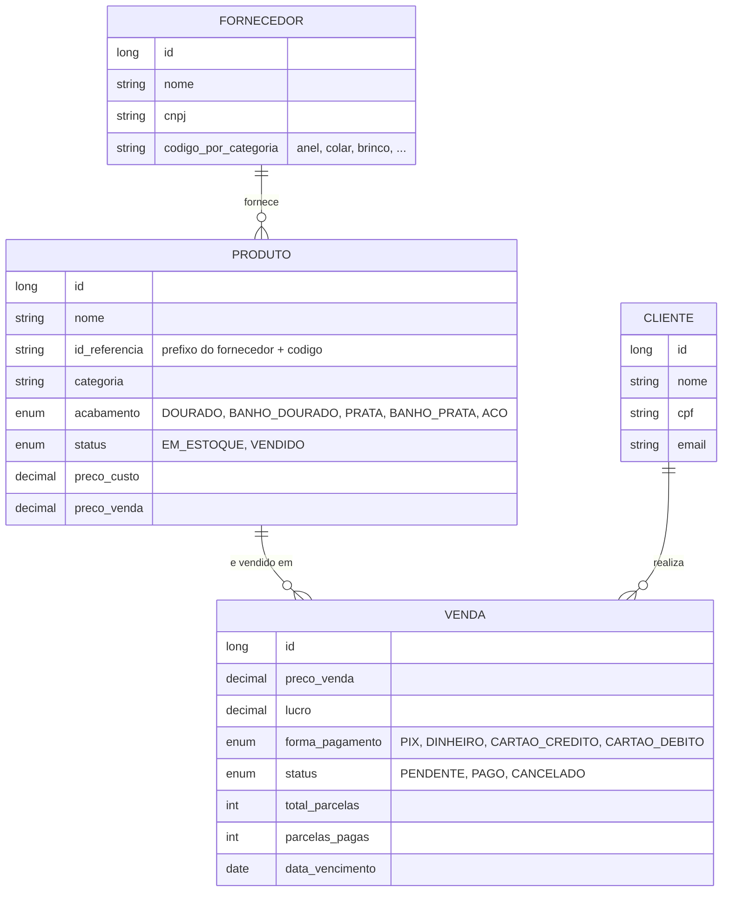

# Gleam API

API REST do Gleam, um sistema de controle de estoque e vendas para joalheria de semijoias. Foi feita como trabalho de conclusão de curso, em equipe, e cobre o ciclo completo de uma peça: entra no estoque pelo fornecedor, é vendida (à vista ou parcelada), pode ser cancelada e volta para o estoque, e alimenta o painel de lucro.

Java 21, Spring Boot 3.5, Spring Data JPA, MySQL 8 e login com Google (OAuth2).

- Interface: [gleam-frontend](https://github.com/vinisebold/gleam-frontend) (Angular 20)
- Demonstração navegável, sem backend: [gleam-tcc.vercel.app](https://gleam-tcc.vercel.app)

## O problema

Em joalheria de semijoias cada peça é um item único, com fornecedor, acabamento e custo próprios. Controlar isso em planilha funciona até a primeira venda parcelada: a peça some do estoque, o lucro depende do custo daquela peça específica e a parcela que ainda não foi paga precisa continuar aparecendo. A API trata a peça como entidade e deixa o banco responder essas perguntas.

## Regras de negócio

Concentradas nos services, onde ficam as transações:

- **Peça única, ciclo curto.** Um produto está `EM_ESTOQUE` ou `VENDIDO`. Registrar uma venda muda o status e grava a data da venda na mesma transação. Uma peça que não está em estoque não pode ser vendida.
- **Peça vendida não é editável.** Alterar um produto com status `VENDIDO` é rejeitado, para o histórico financeiro não mudar depois do fato.
- **Código de referência por fornecedor.** Cada fornecedor define um prefixo por categoria (anel, colar, brinco, pulseira e assim por diante). O código final é o prefixo mais o identificador informado no cadastro, e o cadastro falha se o fornecedor não tiver prefixo para aquela categoria.
- **Lucro calculado na venda.** O lucro de cada venda é o preço de venda menos o custo da peça, gravado no momento do registro.
- **Parcelas.** A venda guarda total de parcelas e parcelas pagas. Cada pagamento incrementa o contador, e a venda vira `PAGO` quando a última parcela é quitada. Uma venda já paga não aceita novo pagamento.
- **Cancelamento devolve a peça.** Cancelar uma venda muda o status para `CANCELADO` e recoloca a peça em estoque, limpando a data de venda.
- **Exclusão preserva o histórico.** Antes de apagar um produto, as vendas que apontam para ele são desvinculadas, em vez de apagadas.

## Modelo de dados



## Endpoints

| Recurso | Rotas |
| --- | --- |
| Produtos | `GET /api/produtos` (paginado; filtros `fornecedorId` e `status`), `POST`, `GET/PUT/DELETE /api/produtos/{id}` |
| Fornecedores | `GET`, `POST`, `GET/PUT/DELETE /api/fornecedores/{id}` |
| Clientes | `GET`, `POST`, `GET/PUT/DELETE /api/clientes/{id}` |
| Vendas | `GET /api/vendas` (paginado; filtro `status`), `POST`, `POST /api/vendas/{id}/pagar-parcela`, `POST /api/vendas/{id}/cancelar` |
| Estoque | `GET /api/estoque/resumo-global`, `GET /api/estoque/resumo-por-categoria` |
| Análises | `GET /api/analises/lucro-total?periodo=`, `GET /api/analises/lucro-grafico?periodo=` |
| Sessão | `GET /api/user/me` |

Os períodos das análises são `DIA`, `SEMANA`, `MES` e `ANO`, conforme o endpoint. Os controllers e services têm Javadoc com os detalhes de cada parâmetro e exceção.

## Autenticação

Login com Google via `oauth2Login` do Spring Security. A sessão é mantida por cookie (`JSESSIONID`), o que exige que a interface e a API sejam acessadas de origens compatíveis com CORS com credenciais. As origens permitidas estão em `SecurityConfig`. Todas as rotas, exceto as de login, exigem sessão autenticada.

## Estrutura

```
com.gleam.backend
├── config/        SecurityConfig (OAuth2, CORS, logout), SessionCookieConfig
├── controller/    camada HTTP, sem regra de negócio
├── service/       regras e transações (venda, produto, análise, ...)
├── repository/    Spring Data JPA; ProdutoSpecification para filtros dinâmicos
├── dto/           contratos de entrada e saída (records)
└── model/         entidades e enums
```

## Rodando localmente

Precisa de JDK 21 ou superior, MySQL 8 e credenciais OAuth do Google (tipo "aplicativo da web") com `http://localhost:8080/login/oauth2/code/google` cadastrado como URI de redirecionamento.

```bash
export PROFILES_APP=dev
export GOOGLE_CLIENT_ID=...
export GOOGLE_CLIENT_SECRET=...
./mvnw spring-boot:run
```

O perfil `dev` usa o banco `gleam_estoque_joias` em `localhost:3306` com usuário `root` e senha vazia, e cria o banco e as tabelas na primeira execução (`ddl-auto=update`). Para outro usuário ou senha, ajuste `application-dev.properties`. Em produção o perfil `prod` lê a conexão de `DB_HOST`, `DB_PORT`, `DB_NAME`, `DB_USERNAME` e `DB_PASSWORD`.

O `Dockerfile` faz build em duas etapas e sobe a aplicação com usuário sem privilégios e heap limitado a 256 MB.

Os testes rodam sem MySQL, com H2 em memória e credenciais de OAuth fictícias:

```bash
./mvnw verify
```

## Limitações conhecidas

- A cobertura de testes é pequena: hoje há apenas o teste de carga de contexto. As regras acima ainda não têm testes unitários.
- O sistema não tem perfis de acesso; qualquer usuário autenticado vê e altera tudo.
- A API publicada que a interface usava foi desativada. A [demonstração](https://gleam-tcc.vercel.app) roda inteira no navegador, com dados fictícios, justamente para poder ser testada sem este backend no ar.

## Autoria

Projeto desenvolvido em equipe por alunos do curso técnico; a lista completa está em [contribuidores](https://github.com/vinisebold/gleam-api/graphs/contributors). Minha parte inclui a camada de segurança (OAuth2, sessão e CORS), a configuração de ambientes, o Dockerfile e o deploy, além de contribuições nos services de produto e venda.
